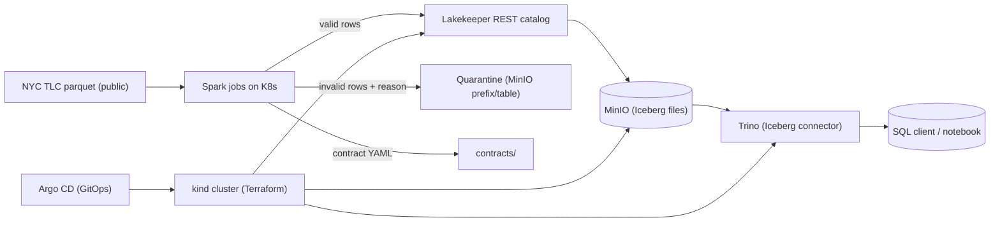

# Lakehouse Platform

Local, open-source, reproducible lakehouse on a single-node Kubernetes cluster.

> Honesty rule: every number in this README comes from a real run saved under
> `experiments/`. Anything not yet measured is marked **TBD** or **not tested**.

## Architecture



- **Infra as code:** Terraform creates a local `kind` cluster (one node).
  Argo CD syncs everything from this repo. No hidden manual step.
- **Storage:** MinIO (S3-compatible) holds Iceberg data files.
- **Catalog:** Lakekeeper `0.13.5` (Iceberg REST, Rust single binary, Postgres 16 backend).
- **Tables:** Apache Iceberg `1.6.1` (Spark 3.5 runtime) on MinIO.
- **Compute:** Spark `3.5.9` jobs on Kubernetes, incremental + idempotent.
- **Query:** Trino `483` (chart `1.44.0`) with Iceberg connector.
- **Contracts & quarantine:** YAML contracts in `contracts/`; schema drift or
  invalid rows go to quarantine with a reason, never silently dropped.
- **Quality:** Great Expectations suites, reports in `experiments/`.
- **Lineage:** OpenLineage + Marquez only if resources allow (see decisions).

## Pinned versions (verified 2026-10-14 from official sources)

| Component | Version | Source |
|---|---|---|
| Python | 3.12.10 | `python --version` |
| Docker Desktop / Engine | 4.78.0 / 29.5.3 | `docker version` |
| kubectl | 1.34.1 | `kubectl version --client` |
| Helm | 4.3.0 | `helm version` |
| Terraform | 1.16.5 | `terraform -version` |
| kind | 0.33.0 | `kind --version` |
| Argo CD app / chart | 3.5.5 / 10.10.3 | GitHub releases + ArtifactHUB |
| MinIO | RELEASE.2025-04-22T22-12-26Z | pinned image tag (pull verified in Phase 3) |
| Lakekeeper | 0.13.5 | `quay.io/lakekeeper/catalog:0.13.5` (Sep 2026) |
| Trino app / chart | 483 / 1.44.0 | trinodb/charts (Oct 2026) |
| Spark | 3.5.9 | apache/spark (Jul 2026) |
| Iceberg Spark runtime | 1.6.1 | Maven Central, Spark 3.5 bundle |
| Postgres | 16.9 | Docker Hub `postgres:16.9-bookworm` |
| TLC data | yellow 2024-01..06 + 2019-01 + 2023-01, zone lookup CSV | `https://d37ci6vzurychx.cloudfront.net/trip-data/` |

## Quickstart (Windows PowerShell)

```powershell
# one-command rebuild from zero (Phase 10):
.\scripts\up.ps1
# tear everything down:
.\scripts\down.ps1
# fast checks without a cluster:
.\scripts\test.ps1
# benchmarks (needs the stack up):
.\scripts\bench.ps1
```

Data download (no login required):

```powershell
.\scripts\download-data.ps1
```

See `docs/RUNBOOK.md` for start/stop/troubleshoot, `docs/DECISIONS.md` for
choices, `docs/LEARNING_NOTES.md` for phase notes.

## Measured results

All **TBD** until `experiments/` contains real runs on this machine.

| Benchmark | Config | Median | Dispersion | Files / data read | Status |
|---|---|---|---|---|---|
| Full reload vs incremental | TBD | TBD | TBD | TBD | not tested |
| Compaction off vs on | TBD | TBD | TBD | TBD | not tested |
| Partitioned vs non-partitioned | TBD | TBD | TBD | TBD | not tested |

## Limits & not tested

- Single-node `kind` on Docker Desktop (WSL2 limited to 20 GB via `.wslconfig`).
- One Trino worker, small Spark executors — explicit resource limits in Helm values.
- No Kafka, no Medallion wording, no Grafana/Loki stack (other projects cover them).
- Lineage (Marquez) deferred to Phase 8 pending a resource check.
