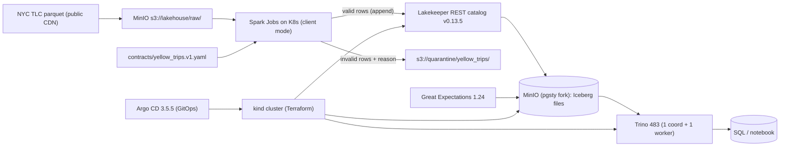

# Lakehouse Platform

Local, open-source, reproducible lakehouse on a single-node Kubernetes cluster.
One command rebuilds everything from code: `.\scripts\up.ps1`.

> Honesty rule: every number below comes from a real run saved under
> `experiments/`. Anything not measured is marked **TBD** or **not tested**.

## Architecture



- **Infra as code:** Terraform (`tehcyx/kind` 0.9.0) creates the `kind` cluster;
  Argo CD syncs from Git once a remote exists (see `docs/DECISIONS.md` D10);
  `scripts/up.ps1` applies the same charts meanwhile. No hidden manual step.
- **Storage:** MinIO-compatible `pgsty/minio` (upstream images discontinued —
  see D09). Buckets `lakehouse` + `quarantine` created by a Job.
- **Catalog:** Lakekeeper `v0.13.5` (Rust single binary, Postgres 16 backend).
- **Tables:** Apache Iceberg 1.6.1 (Spark runtime) on MinIO.
- **Compute:** Spark 3.5.9 jobs on Kubernetes, incremental + idempotent
  (file ledger + append). Layer names: `raw → validated → trusted`
  (no Medallion wording, no Kafka — other projects cover them).
- **Query:** Trino 483 (official chart 1.44.0) with Iceberg REST connector.
- **Contracts & quarantine:** YAML contracts; drift/invalid rows quarantined
  with a reason, never silently accepted.
- **Quality:** Great Expectations suites, JSON reports in `experiments/`.
- **Observability:** health probes, explicit resource limits, `kubectl logs`
  (no Grafana/Loki — covered elsewhere).

## Pinned versions (verified 2026-10-14 from official sources)

| Component | Version | Evidence |
|---|---|---|
| Python / Java | 3.12.10 / Temurin 17.0.20.1 | `python --version`, image build |
| Docker Desktop / Engine | 4.78.0 / 29.5.3 | `docker version` |
| kubectl / Helm / Terraform / kind | 1.34.1 / 4.3.0 / 1.16.5 / 0.33.0 | `--version` |
| K8s (kind node) | 1.33.1 | `kubectl version` |
| Argo CD app / chart | 3.5.5 / 10.10.3 | image tag + `helm list` |
| MinIO (pgsty fork) | RELEASE.2026-08-04T00-00-00Z (`sha256:b6bfe723…`) | `docker pull` |
| Lakekeeper | v0.13.5 (`sha256:3e68fd70…`) | binary `--version` |
| Trino app / chart | 483 / 1.44.0 | chart + queries |
| Spark / Iceberg runtime | 3.5.9 / 1.6.1 | snapshot summaries |
| Postgres | 16.9-bookworm | `docker pull` |
| GX / trino-client / PyIceberg | 1.24.0 / 0.340.0 / 0.12.0 | `pip show` |
| kubeconform (CI) | 0.8.0 | release page |
| TLC data | yellow 2024-01..06 + 2019-01 + 2023-01, zone lookup | `experiments/tlc_schema_report.json` |

## Quickstart (Windows PowerShell)

```powershell
Copy-Item .env.example .env   # demo-local credentials only
.\scripts\download-data.ps1   # TLC parquet -> data/ (git-ignored, ~500 MB)
.\scripts\up.ps1              # cluster + Argo CD + MinIO + Postgres + Lakekeeper + Trino
.\scripts\test.ps1            # ruff, pytest, terraform, helm lint + render (no cluster)
.\scripts\down.ps1            # terraform destroy (data volumes go with the cluster)
```

Load data (inside the cluster, one Job per month):

```powershell
.\scripts\run-ingest.ps1 -Month 2024-01   # repeat for 02..06 (or all, in order)
```

Query + measure:

```powershell
.\.venv\Scripts\python.exe scripts\trino-query.py     # sql/*.sql -> experiments/phase5_*.json
.\.venv\Scripts\python.exe scripts\run-quality.py     # GX gates -> experiments/phase6_*.json
.\.venv\Scripts\python.exe scripts\bench-iceberg.py   # demos + benchmarks -> experiments/phase7_*.json
```

Docs: `docs/RUNBOOK.md` (operate), `docs/DECISIONS.md` (choices),
`docs/LEARNING_NOTES.md` (per-phase notes in French).

## Measured results (same machine, 2026-10-14)

Dataset: 6 yellow-taxi months (2024-01..06), 20 332 093 input rows →
**20 015 099 trusted rows** + 317 994 quarantined (~1.6 %).
Engines: Spark 3.5.9 (2 exec × 3 Go, row-based Iceberg reads), Trino 483
(1 worker, heap 3 Go). Repeats: 5×, median (stdev).

| # | Comparison | Before | After | Source |
|---|---|---|---|---|
| 1 | Incremental replay (2024-01, 2.96 M rows) | — | `skipped_already_loaded`, 0 rows, 0 files | `phase4_replay_2024-01.json`, 50→50 objects |
| 2 | Compaction: March-slice agg query | 4.97 s (1.89) | 3.49 s (0.15) | `phase7_compaction.json` |
| 3 | Compaction: files / bytes | 27 files, 723 MB | 2 files, 667 MB (75.3 s optimize) | `$files`, `optimize` metrics |
| 4 | Partitioning (`month(pickup)`): same query | 3.31 s (unpartitioned) | 2.38 s (partitioned) | `phase7_partitioning.json` |
| 5 | Partitioned build cost (CTAS 20.0 M rows) | — | 106.1 s, 17 files | `phase7_partitioning.json` |
| 6 | Full build (CTAS 2024-01, 2.93 M rows) | — | 21.6 s | `phase7_full_vs_incremental.json` |
| 7 | Incremental append (INSERT 2024-02, 2.97 M rows) | — | 16.2 s | `phase7_full_vs_incremental.json` |
| 8 | Schema evolution (ADD + RENAME COLUMN) | 27 files | 27 files (no rewrite) | `phase7_report.json` |
| 9 | Time travel / rollback | 4 931 rows at oldest snapshot | rollback 4 931 → restore 20 015 099 | `phase7_report.json` |
| 10 | Expire snapshots (1 h demo retention) | 8 snapshots | 1 snapshot (2.5 s) | `phase7_expire.json` |
| 11 | GX trusted sample (200 k rows, 7 expectations) | — | 100 % pass | `phase6_quality.json` |
| 12 | GX quarantine sample (20 k rows, negative control) | — | fails as expected (`fare_amount`, `total_amount`) | `phase6_quality.json` |

Caveats: Trino and Spark read the same table but are different engines (times
not comparable across engines); "before" stdev is inflated by cold caches;
full-vs-incremental slices differ by month (sizes within 1.5 %).

## Limits & not tested

- Single-node `kind` on Docker Desktop; WSL2 capped at 20 GB (`.wslconfig`).
- Spark Iceberg reads require `spark.sql.iceberg.vectorization.enabled=false`
  here (vectorized/Arrow reader segfaults this JVM under WSL2/Docker — D14).
- `MERGE INTO` on the 20 M-row table OOMs this node; ingestion uses a
  file ledger + append (D13).
- Marquez/OpenLineage **not deployed** (node at 67 % mem / 107 % CPU limits;
  static provenance in `experiments/phase8_lineage.json` instead — D18).
- Argo CD syncs from Git only after a remote is added (D10); `up.ps1` applies
  the same charts until then.
- CI has no cluster (lint/unit/render/kubeconform only); Spark container tests
  run on demand, not in CI.
- TLC `airport_fee`→`Airport_fee` rename + int32/int64 drift handled by
  case-insensitive normalization; full historical backfill not tested.
