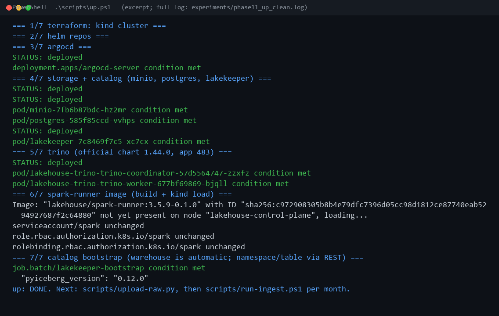
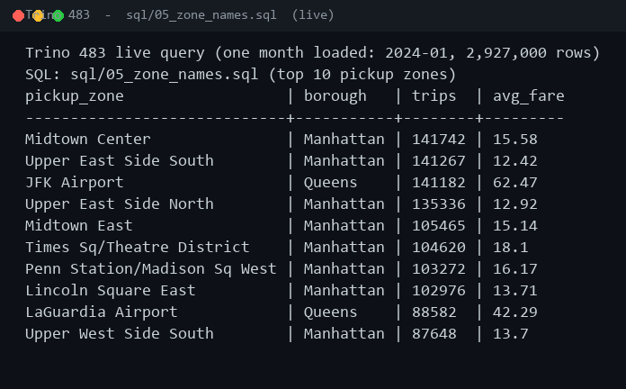
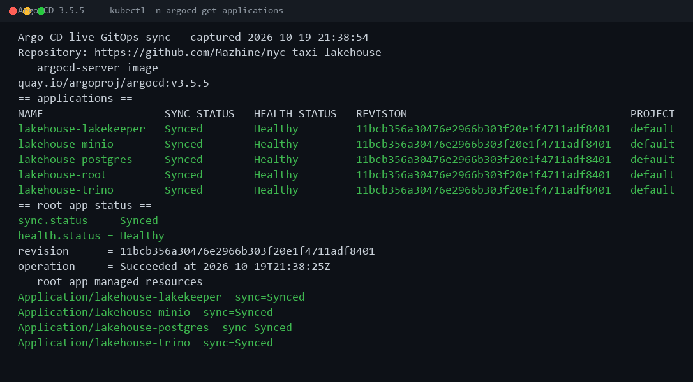
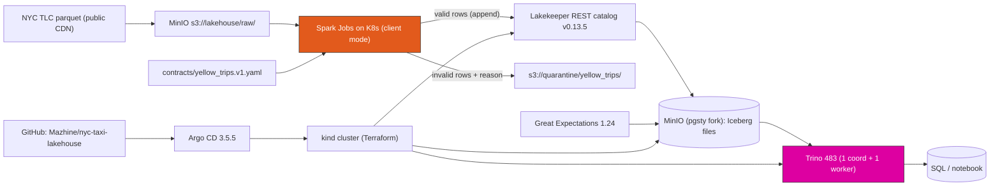

# nyc-taxi-lakehouse

### A Reproducible & Measured Data Platform in a Box


[](https://github.com/Mazhine/nyc-taxi-lakehouse/actions/workflows/ci.yml)

An end-to-end, local data platform built on an open-source lakehouse stack:
**MinIO** object storage, an **Apache Iceberg** REST catalog (**Lakekeeper**),
**Spark** ingestion on **Kubernetes**, and **Trino** for SQL — all created from
code by Terraform and Helm, and all rebuilt with a single command. The project
is deliberately *measured*: every performance and correctness number published
below is produced by a real run saved under `experiments/`.

> Honesty rule: anything not measured is marked **TBD** or **not tested**, and
> every design trade-off is written down in `docs/DECISIONS.md`.

## Key results

- **20.0 M trips** queryable in Iceberg/Trino — 20,015,099 trusted rows from 20,332,093 input rows.
- **1.56 % quarantined with a reason** (316,994 rows) — never silently dropped or mixed into the trusted table.
- **Rebuild verified 8/8** by `scripts/verify.ps1` after a full `down` → `up` → reload (20,015,099 rows).
- **5 Argo CD applications** `Synced` / `Healthy` from this GitHub repository (evidence in `experiments/`).

## Demo

Terminal captures from real runs (full logs under `experiments/`). The GIF cycles
through the three steps; individual images are in `docs/media/`.


| Step | Capture | Real artifact |
|---|---|---|
| One-command rebuild |  | `experiments/phase11_up_clean.log` |
| Live Trino query |  | `experiments/phase11_trino_demo.txt` |
| Argo CD GitOps sync |  | `experiments/phase11_argocd_sync.txt` |

## Business Impact

This platform turns a raw public dataset into an analytics-ready asset and makes
the result reproducible:

- **20.0 M trips made queryable.** Six months of NYC yellow-taxi data
  (20,332,093 input rows) become 20,015,099 trusted rows in an Iceberg table
  queryable with plain SQL through Trino.
- **Bad data is isolated, not hidden.** 316,994 rows (1.56 %) fail a contract
  rule and are written to a quarantine zone with the reason, so downstream
  numbers never silently mix valid and invalid records.
- **The platform is rebuilt from code, not from memory.** `scripts/up.ps1`
  recreates the cluster and all services in 7 steps; a fresh rebuild is checked
  by `scripts/verify.ps1` (8/8 checks pass on 20,015,099 rows).
- **Cost and lock-in stay low.** Everything runs on one laptop with open-source
  components; no cloud account or proprietary warehouse is required.

## System Architecture



- **Infra as code:** Terraform (`tehcyx/kind` 0.9.0) creates the `kind` cluster;
  Argo CD syncs the Helm charts from this GitHub repository (see the Demo above
  and `docs/DECISIONS.md` D10).
- **Storage:** MinIO-compatible `pgsty/minio` (upstream images discontinued —
  see D09). Buckets `lakehouse` + `quarantine` created by a Job.
- **Catalog:** Lakekeeper `v0.13.5` (Rust single binary, Postgres 16 backend).
- **Tables:** Apache Iceberg 1.6.1 (Spark runtime) on MinIO.
- **Compute:** Spark 3.5.9 jobs on Kubernetes, incremental + idempotent
  (file ledger + append). Layer names: `raw → validated → trusted`.
- **Query:** Trino 483 (official chart 1.44.0) with the Iceberg REST connector.
- **Contracts & quarantine:** YAML contracts; drift/invalid rows quarantined
  with a reason, never silently accepted.
- **Quality:** Great Expectations suites, JSON reports in `experiments/`.
- **Observability:** health probes, explicit resource limits, `kubectl logs`.

## Technology Stack

### 1. Infrastructure as Code and GitOps
* **Terraform + `tehcyx/kind`:** creates the single-node Kubernetes cluster and
  publishes the service ports on the host (MinIO 9000/9001, Lakekeeper 8181,
  Trino 8080, custom NodePorts).
* **Helm charts (`infra/helm/`):** one chart per component, explicit CPU/memory
  requests and limits everywhere, demo-local credentials in values.
* **Argo CD 3.5.5:** app-of-apps under `infra/argocd/`; the live cluster syncs
  from `https://github.com/Mazhine/nyc-taxi-lakehouse` and reports all five
  applications `Synced`/`Healthy` (evidence in `experiments/phase11_argocd_sync.txt`).

### 2. Storage and Catalog
* **MinIO (`pgsty/minio` fork):** S3-compatible object storage holding both the
  raw uploads and the Iceberg data/metadata files.
* **PostgreSQL 16:** stores the catalog metadata only (namespaces, table and
  snapshot pointers) — never the trip data itself.
* **Lakekeeper `v0.13.5`:** Iceberg REST catalog shared by Spark (writes) and
  Trino (reads).

### 3. Ingestion and Transformation (Spark on Kubernetes)
* **Apache Spark 3.5.9** (client mode, 1 driver + 2 executors): reads monthly
  TLC parquet from `s3://lakehouse/raw/`, validates rows against the contract,
  appends valid rows to Iceberg, and writes rejected rows to a quarantine zone.
* **Incremental + idempotent:** a file ledger makes replays return
  `skipped_already_loaded` with zero new files (no duplicate data).
* **Zone reference load:** a dedicated Job loads the 265-row
  `taxi_zone_lookup.csv` into `nyc.taxi_zones` for joins (`sql/05_zone_names.sql`).

### 4. Query and Analytics
* **Trino 483** (1 coordinator + 1 worker, official chart 1.44.0): plain SQL on
  the Iceberg tables through the REST catalog — time travel, snapshots, rollback.
* **Iceberg maintenance:** compaction, `expire_snapshots`, partitioning
  (`month(pickup)`), schema evolution — all scripted and benchmarked.

### 5. Data Quality, Testing and CI
* **Great Expectations 1.24:** expectation suites over the trusted table, plus a
  quarantine *negative control* that is expected to fail.
* **pytest + ruff:** unit tests for contracts/transforms/quarantine/verify logic
  and lint/format gates.
* **GitHub Actions:** lint, unit tests, `terraform validate`, `helm lint`,
  `kubeconform` rendering, and Spark tests in `apache/spark:3.5.9` (CI has no
  cluster).

## Data Source

The dataset is the **NYC TLC Trip Record Data** (yellow taxi), published by the
New York City Taxi & Limousine Commission:
<https://www.nyc.gov/site/tlc/about/tlc-trip-record-data.page>.

This project uses the monthly Parquet files for **2024-01 through 2024-06**
(plus the `taxi_zone_lookup.csv` zone reference). The raw files are downloaded
by `scripts/download-data.ps1` into `data/` (git-ignored, not redistributed
here). The TLC data is public; see the TLC page for its terms of use.

## Prerequisites and Installation

* **Docker Desktop** (with WSL2 backend; `.wslconfig` capped at 20 GB) on
  Windows, plus **PowerShell 5.1**.
* **kubectl 1.34**, **Helm 4.3**, **Terraform 1.16.5**, **kind 0.33**.
* **Python 3.12** with the pinned packages in `requirements.txt`
  (`pyspark 3.5.9`, `pyiceberg 0.12.0`, `boto3`, `trino 0.340.0`,
  `great-expectations 1.24.0`).
* Public internet access to download the NYC TLC parquet files (~500 MB).

## Execution and Command Reference

```powershell
.\scripts\download-data.ps1   # NYC TLC parquet -> data/ (git-ignored, ~500 MB)
.\scripts\up.ps1              # 7 steps: cluster + Argo CD + MinIO + Postgres + Lakekeeper + Trino + Spark image
.\scripts\test.ps1            # ruff, pytest, terraform, helm lint + render (no cluster)
.\scripts\down.ps1            # terraform destroy (data volumes go with the cluster)
```

Load data (one Kubernetes Job per month), then query, verify and measure:

```powershell
.\scripts\run-ingest.ps1 2024-01   # positional month; repeat for 02..06, in order
.\scripts\load-zones.ps1           # 265-row reference table used by sql/05_zone_names.sql

.\scripts\verify.ps1                                  # acceptance: rowcount + conservation + identical SQL results
.\.venv\Scripts\python.exe scripts\trino-query.py     # sql/*.sql -> experiments/phase5_*.json
.\.venv\Scripts\python.exe scripts\run-quality.py     # GX gates -> experiments/phase6_*.json
.\scripts\bench.ps1                                   # Iceberg demos + benchmarks -> experiments/phase7_*.json
```

GitOps (Argo CD is installed by `up.ps1`; this registers the app-of-apps):

```powershell
kubectl apply -f infra/argocd/root-app.yaml
kubectl -n argocd get applications   # expect all apps Synced / Healthy
```

Docs: `docs/RUNBOOK.md` (operate), `docs/DECISIONS.md` (choices),
`docs/LEARNING_NOTES.md` (per-phase notes in French), `CONTRIBUTING.md`,
`architecture.md`.

## Web Interfaces and Credentials

*All credentials are demo-local and fixed in the chart values. Override them
with `--set` for any shared use; no `.env` file is needed.*

| Service | URL | Username | Password | Purpose |
|---------|-----|----------|----------|---------|
| **MinIO Console** | [localhost:30091](http://localhost:30091) | `minioadmin` | `minioadmin-local-demo-only` | Browse the raw + quarantine buckets |
| **Trino** | [localhost:30080](http://localhost:30080) | — | — | SQL engine UI / JDBC endpoint |
| **Lakekeeper** | [localhost:30818](http://localhost:30818) | — | — | Iceberg REST catalog API |
| **Argo CD** | `kubectl port-forward -n argocd svc/argocd-server 8080:443` | `admin` | see command below | GitOps dashboard |
| **Spark UI** | per-job (see `experiments/` logs) | — | — | Spark job monitoring |

The Argo CD admin password is generated at install time:

```powershell
kubectl -n argocd get secret argocd-initial-admin-secret -o jsonpath='{.data.password}'
# then decode the printed base64 value with: base64 -d
```

## Measured Results (same machine, 2026-10)

Dataset: 6 yellow-taxi months (2024-01..06), **20,332,093 input rows** =
**20,015,099 trusted rows** + **316,994 quarantined rows** (1.56 %).
Engines: Spark 3.5.9 (2 exec × 3 Go, row-based Iceberg reads), Trino 483
(1 worker, heap 3 Go). Repeats: 5×, median (stdev).

| # | Comparison | Before | After | Source |
|---|---|---|---|---|
| 1 | Incremental replay (2024-01, 2.96 M rows) | — | `skipped_already_loaded`, 0 rows, 0 files | `phase4_replay_2024-01.json`, 50→50 objects |
| 2 | Compaction: March-slice agg query | 4.97 s (1.89) | 3.49 s (0.15) | `phase7_compaction.json` |
| 3 | Compaction: files / bytes | 27 files, 723 MB | 2 files, 667 MB (75.3 s optimize) | `$files`, `optimize` metrics |
| 4 | Partitioning (`month(pickup)`): same query | 3.31 s (unpartitioned) | 2.38 s (partitioned) | `phase7_partitioning.json` |
| 5 | Partitioned build cost (CTAS 20.0 M rows) | — | 106.1 s, 17 files | `phase7_partitioning.json` |
| 6 | Full build (CTAS 2024-01, 2.93 M rows) | — | 21.6 s | `phase7_full_vs_incremental.json` |
| 7 | Incremental append (INSERT 2024-02, 2.97 M rows) | — | 16.2 s | `phase7_full_vs_incremental.json` |
| 8 | Schema evolution (ADD + RENAME COLUMN) | 27 files | 27 files (no rewrite) | `phase7_report.json` |
| 9 | Time travel / rollback | 4,931 rows at oldest snapshot (5,000-row smoke test) | rollback 4,931 → restore 20,015,099 | `phase7_report.json` |
| 10 | Expire snapshots (1 h demo retention) | 8 snapshots | 1 snapshot (2.5 s) | `phase7_expire.json` |
| 11 | GX trusted sample (200 k rows, 7 expectations) | — | 100 % pass | `phase6_quality.json` |
| 12 | GX quarantine sample (20 k rows, negative control) | — | fails as expected (`fare_amount`, `total_amount`) | `phase6_quality.json` |
| 13 | Full teardown + rebuild (`down` → `up` → reload) | 20,015,099 rows | 7/7 steps, all checks pass | `phase10_rebuild.txt`, `verify.ps1` |
| 14 | Acceptance check on a fresh rebuild (`verify.ps1`) | — | 8/8 PASS, 20,015,099 rows, 6 snapshots | `phase10_verify.txt` |

Caveats: Trino and Spark read the same table but are different engines (times
not comparable across engines); "before" stdev is inflated by cold caches;
full-vs-incremental slices differ by month (sizes within 1.5 %). The 4,931-row
oldest snapshot is the initial 5,000-row smoke-test ingest of 2024-01
(`--limit 5000`), not a month: it is the first entry in that table history. The
clean six-month rebuild starts at 2,927,000 rows (`phase5_04_snapshots.json`).

### Why rows are quarantined

`verify-results.py` now checks conservation per source and overall
(`input = valid + quarantine`). The breakdown below is recomputed offline from
the raw files with the same rule expressions (`scripts/quarantine-reasons.py`,
artifact `experiments/phase4_quarantine_reasons.json`). A row can break several
rules, so rule counts overlap and do not sum to the total.

| Rule (quarantine reason) | Rows | Share of quarantine |
|---|---|---|
| `fare_amount_invalid` (negative or null) | 315,747 | 99.6 % |
| `total_amount_invalid` (negative or null) | 257,431 | 81.2 % |
| `pickup_before_dropoff` | 300 | 0.09 % |
| `trip_distance_invalid` (negative or null) | 0 | 0 % |
| `location_ids_invalid` (zero or null) | 0 | 0 % |
| **Quarantined rows (distinct)** | **316,994** | **100 %** |
| Rows matching more than one rule | 256,484 | — |

## Limits and Not Tested

- Single-node `kind` on Docker Desktop; WSL2 capped at 20 GB (`.wslconfig`).
- Spark Iceberg reads require `spark.sql.iceberg.vectorization.enabled=false`
  here (vectorized/Arrow reader segfaults this JVM under WSL2/Docker — D14).
- `MERGE INTO` on the 20 M-row table OOMs this node; ingestion uses a
  file ledger + append (D13). Atomicity limits are discussed in
  `docs/LEARNING_NOTES.md`.
- Marquez/OpenLineage **not deployed** (node at 67 % mem / 107 % CPU limits;
  static provenance in `experiments/phase8_lineage.json` instead — D18).
- Argo CD is demonstrated on the live cluster, but `up.ps1` also applies the
  charts directly so a rebuild does not depend on Argo being reachable.
- CI has no cluster (lint/unit/render/kubeconform + Spark container tests);
  a full `up.ps1` + ingest run is not automated in CI.
- TLC `airport_fee`→`Airport_fee` rename + int32/int64 drift handled by
  case-insensitive normalization; full historical backfill not tested.

## Repository Structure

| File / Directory | Role |
|---|---|
| `src/ingestion/` | Spark ingestion job (`ingest.py`) + zone reference loader (`load_zones.py`) |
| `src/quarantine/` | Quarantine writer — rejected rows with a normalized reason |
| `src/quality/`, `src/benchmarks/`, `src/maintenance/` | GX probes, Iceberg benchmarks (compaction/partitioning/expiry), table counts |
| `contracts/yellow_trips.v1.yaml` | Schema + 5 data-quality rules + quarantine target |
| `sql/01..05_*.sql` | Verification + analytics SQL (rowcounts, zones, joins) |
| `scripts/*.ps1` | Operator entry points: `up`/`down`/`test`/`run-ingest`/`load-zones`/`verify`/`bench`/`download-data` |
| `scripts/*.py` | Helpers: raw upload, TLC inspection, Trino runner, GX gate, verifier, lineage export, quarantine breakdown |
| `infra/terraform/` | kind cluster + port mappings (`tehcyx/kind` provider) |
| `infra/helm/` | One Helm chart per component (minio, postgres, lakekeeper, spark-jobs, trino, argocd) |
| `infra/argocd/` | Argo CD app-of-apps (`root-app.yaml` + `apps/data-plane.yaml`) |
| `docker/spark-runner.Dockerfile` | Spark 3.5.9 + JRE 17 + Iceberg/S3A jars, jobs baked at `/opt/spark/jobs` |
| `tests/` | pytest: contracts, transforms, quarantine, verify, Spark (containerized) |
| `experiments/` | All raw evidence: JSON benchmarks, GX reports, phase logs, Argo CD sync |
| `docs/` | `RUNBOOK.md`, `DECISIONS.md` (D00–D20), `LEARNING_NOTES.md`, media captures |
| `.github/workflows/ci.yml` | CI: lint, unit tests, terraform, helm lint, kubeconform, Spark tests |

## License

Released under the [MIT License](LICENSE).

## Data attribution

Data source: NYC Taxi & Limousine Commission (TLC) Trip Record Data,
<https://www.nyc.gov/site/tlc/about/tlc-trip-record-data.page>.
